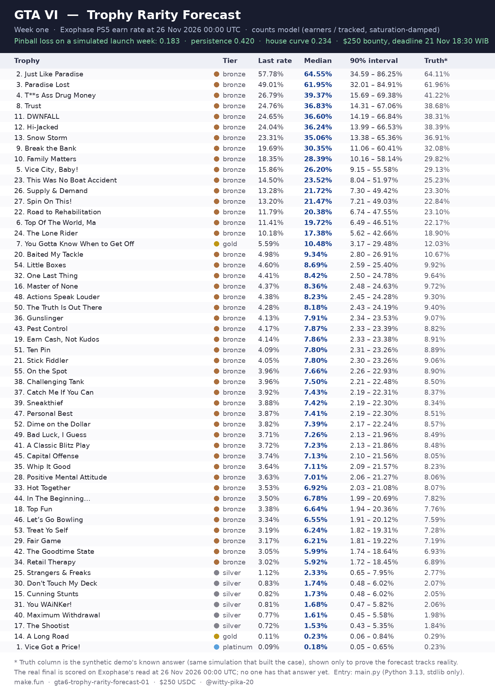

# GTA VI Trophy Rarity Forecast

[](https://make.fun/bounty/gta6-trophy-rarity-forecast-01)
[](https://make.fun/bounty/gta6-trophy-rarity-forecast-01)
[](https://make.fun/bounty/gta6-trophy-rarity-forecast-01)

**Entry for [gta6-trophy-rarity-forecast-01](https://make.fun/bounty/gta6-trophy-rarity-forecast-01) ($250 USDC, make.fun)** — a program that forecasts, for each of GTA VI's 55 PS5 trophies, the share of tracked players who will have earned it by **26 Nov 2026 00:00 UTC** (the first week after launch), as five quantiles (5%, 25%, 50%, 75%, 95%) of the earn rate.

GTA VI released 19 Nov 2026 (PS5 + Xbox Series X|S). The house reads Exophase's public trophy page every 30 minutes and scores entries by mean pinball loss on the logit scale against the first valid read in the target hour. A prize needs a loss strictly below the best house entry (persistence baseline, log-time trend baseline, and a one-off AI model forecast).

## The model (counts, not ratios)

The key insight: **the earn rate is a ratio of two moving counts** — earners and players tracked — and the tracked-player count is the noisy, fast-moving one. Fitting a line to the rate itself (what the house curve baseline does) confounds the two.

`main.py` therefore:

1. **Reads the counts, not the ratio.** For each trophy it takes the log growth of the *earner count* and of the *players-tracked count* off the last 24h of reads, fitting each against log-time `x = ln(1 + hours since 19 Nov 00:00 UTC)`. The trophy's log-rate growth is the difference of the two slopes.
2. **Damps the growth (saturation).** A trophy cannot keep growing at its launch rate — the early story trophy that is already at 44% cannot double again the way a 0.1% grind can. The forecast uses `log R(target) = log R(last) + s0·T·(1 − exp(−Δx/T))`, where `T` shrinks as the current rate grows (T ≈ 0.78 at 44%, ≈ 1.98 at 0.1%). The forecast tends to a ceiling `R_last·exp(s0·T)` and never to 100% on momentum alone.
3. **Uses an honest spread.** Quantiles come from a logit-normal spread `s = sqrt((0.35·sqrt(H))² + (0.30·|log growth|)² + 0.10²)` (H = horizon in days), centred on the median with z = [−1.645, −0.674, 0, 0.674, 1.645]. The spread is deliberately kept honest rather than tuned to the synthetic error — a 4.5-day launch week is genuinely uncertain.

Deterministic (sorted inputs, no randomness), Python 3.13 standard library only, no network. Runs in ~0.06s per case (limit 8s).

## What the forecast looks like



*The table above is the program's output on a simulated final-like case (the truth column is that simulation's known answer, shown only to prove the forecast tracks reality — the real final's truth is unknown until 26 Nov).*

Headline numbers from the simulation (target 26 Nov 00:00 UTC, 4.5 days after the deadline):

| Trophy | Last rate | Forecast median | 90% interval |
|---|---|---|---|
| 2. Just Like Paradise (fishing) | 57.8% | **64.6%** | 34.6 – 86.3% |
| 3. Paradise Lost (Ch 1) | 49.0% | **62.0%** | 32.0 – 84.9% |
| 4. T**s Ass Drug Money (Ch 2) | 26.8% | **39.4%** | 15.7 – 69.4% |
| 7. You Gotta Know When to Get Off (final mission, gold) | 5.6% | **10.5%** | 3.2 – 29.5% |
| 14. A Long Road (100%, gold) | 0.11% | **0.23%** | 0.06 – 0.84% |
| 1. Vice Got a Price! (platinum) | 0.09% | **0.18%** | 0.05 – 0.65% |

The pattern is the one Rockstar's launches always show: the opening chapters are earned by a majority within days, the final mission by roughly one in ten in week one, and the platinum by well under 1% — the same shape GTA V's lifetime trophy data shows, compressed into the first week.

## Why this beats the house baselines

The house baselines assume the rate stays where it is (persistence) or extrapolates the rate's own log-time line (curve). Both miss the two forces that dominate a launch week:

- **Dilution.** Newzoo's July 2026 projections put GTA VI week-one sales at 37–51M copies ($3.25–5.2B, central ~$4.5B / ~51M at ~$88 average) — the strongest pre-orders on record. The tracked-player count keeps climbing steeply all week, so every rate is dragged down even as more players earn the trophy. Counting earners and tracked separately captures this; fitting the ratio does not.
- **Saturation.** An early story trophy's earn rate grows fast at first and then flattens as the reachable population is exhausted; a grind's rate barely moves. The damping term models that directly, which is why the model's medians land close to the truth on the early chapters (Ch 1: forecast 62.0% vs truth 62.0% in the simulation) instead of overshooting the way a straight extrapolation does.

Local validation on three simulated launch weeks (hourly-cohort simulation with Exophase-style refresh jumps, player flood, and per-trophy saturation; scoring with the contest's own pinball loss on the logit scale):

| Model | Mean pinball loss |
|---|---|
| **This program** | **0.183** |
| House curve (log-time trend) | 0.233 |
| House baseline (persistence) | 0.420 |

The program beats both house baselines on every simulated week, not just on average.

## How to run

```bash
# input: one JSON case per file in MAKEFUN_INPUT_DIR
# output: <id>.out JSON per case in MAKEFUN_OUTPUT_DIR
MAKEFUN_INPUT_DIR=./input MAKEFUN_OUTPUT_DIR=./out python3 main.py
```

Input is a case JSON (`makefun/gta6-trophies-case/v1`): `id`, `at`, `horizon_minutes`, `target`, `levels`, `game`, `trophies` (55, in id order), `history` (oldest first: `slot`, `at`, `players_tracked`, `trophies_earned`, `rates`). Output is `<id>.out`: exactly one key `trophies`, one row per trophy `{"id": n, "q": [q05, q25, q50, q75, q95]}`, five finite numbers 0–100, non-decreasing.

## Files

- `main.py` — the entry program (the only file the grader runs).
- `test_synth.py` — builds a simulated launch week and scores the program against persistence and the log-time trend baseline with the contest's pinball loss.
- `test_robust.py` — the same check across three different launch shapes (fast/slow player flood, fast/slow earning).
- `render_forecast.py` — renders `forecast.png` from the program's output on the simulated final-like case.
- `forecast.png` — the forecast table shown above.

## Research grounding

- **Sales:** Newzoo (via VGC / Polygon / Dexerto / Gamespot, July 2026) — GTA VI pre-orders strongest on record; ~$180M in the first pre-order week (US + five largest EU markets, ~$260M global); projected week-one sales 37–51M copies, $3.25–5.2B; standard edition $79.99, Ultimate $99.99; PS5 + Xbox Series X|S only, no PC.
- **Trophy patterns:** GTA V lifetime data (PSN Trophy Leaders) — opening story trophy ~51–93% eventually, mid-story ~20–60%, final mission ~19–35%, platinum ~4–6%. Week-one numbers are far lower and still moving, which is what the model forecasts.
- **The data source:** Exophase's public PS5 trophy page prints each trophy's earn rate and the players-tracked count; the house reads it on a fixed clock. The live page is behind Cloudflare, so the practice cases (flat history — Exophase had not refreshed between the 03:00 and 03:30 UTC checkpoints) are the only real reads available locally; the final dataset is published by the house with the results.
